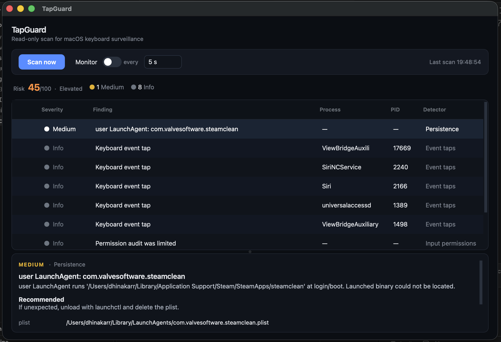

# TapGuard

*A macOS keylogger detector.*


A defensive, blue-team tool that scans macOS for software keyloggers and
keyboard-surveillance behaviour, then reports what it finds in a clear GUI.

> **Read-only by design.** The detector only *inspects* the system. It never
> installs hooks, captures keystrokes, or modifies anything. It is built to
> find surveillance, not to perform it.

## Screenshot



## The threat it defends against

Software keyloggers on macOS almost always rely on a small set of OS
mechanisms to see what you type. A legitimate monitoring tool and a malicious
one leave the same fingerprints — so the defender's job is to surface those
fingerprints and let a human judge them.

## How it detects

| Signal | What it looks for |
| --- | --- |
| **Event taps** | Processes holding a *listening* Core Graphics event tap on keyboard events (`kCGEventKeyDown` / `kCGEventKeyUp` / `kCGEventFlagsChanged`), enumerated via `CGGetEventTapList`. This is the classic software-keylogger signature. |
| **Input permissions** | Apps granted **Input Monitoring** or **Accessibility** — the permissions a keylogger needs — cross-checked against what you'd expect to be there. |
| **Persistence** | Suspicious `LaunchAgents` / `LaunchDaemons` and login items that would relaunch a logger at startup. |

Each finding is scored by severity and shown with the responsible process and a
recommended action, so you can triage quickly.

## Status & roadmap

- ✅ **macOS** — current focus.
- ⏳ **Windows** — planned as a follow-up release (low-level `WH_KEYBOARD_LL`
  hook detection + autostart/registry audit). The codebase is structured with a
  per-platform detector package so Windows slots in without reworking the core.

## Requirements

- macOS
- Python 3.10+
- Dependencies in `requirements.txt` (PySide6 for the GUI, pyobjc for the
  macOS APIs)

Some checks need **Input Monitoring** / **Accessibility** / **Full Disk
Access** granted to your terminal or to the app, to read the relevant system
state. The tool tells you when a check is limited by missing permission.

## Install

```bash
git clone https://github.com/derryraja/TapGuard.git
cd TapGuard
python3 -m venv .venv && source .venv/bin/activate
pip install -r requirements.txt
```

## Usage

```bash
python run.py
```

Click **Scan** to run all detectors and review the findings.

## Disclaimer

This tool is for defending systems you own or are authorised to inspect. It
reports system state for human review and makes no automated judgement that a
given process is malicious.

## License

MIT — see [LICENSE](LICENSE).
